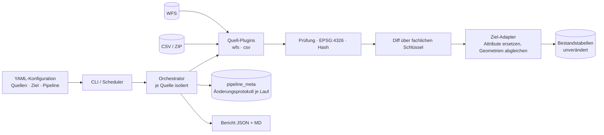

# mosidi-geoimport

Konfigurierbare, quelloffene Import-Pipeline für Geodaten: **WFS- und CSV-Quellen → PostgreSQL/PostGIS**.
Entwickelt von der RIT Services GmbH, Köln, für das Projekt MOSIDI der Technischen Hochschule Brandenburg.

## Zweck

mosidi-geoimport liest Geodaten aus OGC-Web-Feature-Services (WFS 2.0/1.1) und aus CSV-Dateien (lokal oder per
URL, auch in ZIP-Archiven), prüft sie, transformiert alle Geometrien nach EPSG:4326 und schreibt sie in bestehende
PostgreSQL/PostGIS-Tabellen, **ohne deren Struktur zu verändern**. Je Quelle werden in einer eigenen Transaktion
die Attribute ersetzt und die Geometrien über ihren fachlichen Schlüssel aktualisiert (Geometrien werden nie
gelöscht) – aber nur nach vollständigem, fehlerfreiem Abruf; fällt eine Quelle aus, bleiben ihre Daten
unverändert und die übrigen Quellen werden trotzdem importiert. Datensätze werden über einen fachlichen Schlüssel je
Quelle (z. B. den Amtlichen Gemeindeschlüssel) verknüpft und verglichen. Nach jedem Lauf entsteht ein
maschinenlesbarer Import-Bericht (JSON, zusätzlich Markdown) mit neuen, geänderten und entfernten Datensätzen,
Fehlern und Warnungen. Neue Quellen werden per YAML-Datei angebunden, ohne Änderung am Programmcode.

## Architektur



Python 3.12, psycopg 3, GDAL/pyogrio, shapely, pyproj, pandas. Läuft als Linux-Container; Zeitsteuerung mit
supercronic. Details: [Architektur](docs/architektur.md) · [Datenmodell](docs/datenmodell.md) ·
[Import-Bericht](docs/import_bericht.md)

## Schnellstart

Voraussetzung: Docker mit Compose v2.

```bash
cp .env.example .env              # POSTGRES_PASSWORD und MAP_DB_PASSWORD setzen (keine Standardwerte)
docker compose up -d              # PostGIS-Datenbank (Demo-Referenzmodell) und Scheduler
docker compose run --rm pipeline run    # sofort einen Lauf über alle aktiven Quellen
docker compose run --rm pipeline report # letzter Bericht (auch unter /data/reports/latest.json)
```

Das eigenständige `compose.yaml` bringt eine eigene PostGIS-Datenbank mit einem Demo-Referenzmodell mit. Für die
Einbindung als zusätzlicher Container in das bestehende MOSIDI-Compose (Datenbank `brandenburg_db`) gibt es
`compose.mosidi.yaml`; die Schritte stehen im [Betriebshandbuch](docs/betriebshandbuch.md).

Weitere Befehle: `validate-config`, `check-target`, `run --source <id> [--dry-run]`, `probe --source <id>`,
`sources`, `crontab`. Optionale Demo-Karte: `docker compose --profile demo up -d map` → http://127.0.0.1:8080

## Konfiguration der Quellen

Eine YAML-Datei je Quelle unter `config/sources/`. Pflicht sind unter anderem der fachliche Schlüssel
(`business_key`) und der Zeitplan (`schedule`: `daily`, `weekly`, `monthly` oder Cron; mindestens monatlich).

```yaml
id: geobasis_bb_gemeinden
type: wfs
title: "Gemeinden Brandenburg (LGB, Verwaltungsgrenzen)"
license: "dl-de/by-2-0"
schedule: weekly
wfs: {url: "https://isk.geobasis-bb.de/ows/vg_wfs", type_name: "app:gem", request_crs: "EPSG:25833"}
business_key: ["ags"]
key_normalize: {ags: {zfill: 8}}
mapping: {name: gem_name, attributes: {ags: ags}}
target: {dataset: "geobasis_bb_gemeinden"}
```

Die Abbildung auf die drei Zieltabellen (Metadaten, Geometrien, Attribute) steht in `config/target.yaml`.
Anleitung: [Neue Quelle anbinden](docs/neue_quelle_anbinden.md). Prüfen: `docker compose run --rm pipeline validate-config`.

| ID | Typ | Quelle | Lizenz / Quellenvermerk | Status |
|---|---|---|---|---|
| `geobasis_bb_gemeinden` | WFS | LGB Verwaltungsgrenzen `vg_wfs`, FeatureType `app:gem` (413 Gemeinden) | © GeoBasis-DE/LGB, dl-de/by-2-0 | aktiv |
| `inkar_gemeinden` | CSV (URL, ZIP) | INKAR (BBSR), Gemeinden Brandenburg | Datenbasis: Laufende Raumbeobachtung des BBSR; Nutzungsbedingungen in Prüfung | aktiv |
| `afs_bb` | CSV (URL, Ersatzdatei) | Bevölkerung der Gemeinden (Regionalstatistik, Tabelle 12411-01-01-5-B) | © Statistische Ämter des Bundes und der Länder, dl-de/by-2-0 | aktiv, Datensatz abzustimmen |
| `TODO_TH_wfs_quelle_2`, `…_3` | WFS | weitere Dienste, abzustimmen | – | Platzhalter, deaktiviert |

## Tests

```bash
pip install -r requirements.lock && pip install -e ".[dev,webmap]"
make test-db                       # PostGIS für die Integrationstests (Docker)
make test                          # Unit-, Integrations- und End-to-End-Tests mit Abdeckung
make lint                          # ruff, mypy (strict)
```

Die End-to-End-Tests laufen gegen aufgezeichnete Antworten bzw. synthetische Dateien; `make acceptance` wiederholt den
Lauf gegen die echten Quellen (Protokoll unter `docs/abnahme/`).

## Dokumentation

| Dokument | Inhalt |
|---|---|
| [Betriebshandbuch](docs/betriebshandbuch.md) | Installation, Einbindung in MOSIDI, Konfiguration, Betrieb, Störungen |
| [Neue Quelle anbinden](docs/neue_quelle_anbinden.md) | WFS und CSV per YAML, Schritt für Schritt |
| [Entwicklung](docs/entwicklung.md) | Tests, Fixtures, neuer Quelltyp, neuer Ziel-Adapter |
| [Datenmodell](docs/datenmodell.md) | Zieltabellen, Abbildung, Attribute ersetzen + Geometrien abgleichen, `pipeline_meta` |
| [Import-Bericht](docs/import_bericht.md) | Format, Statuswerte, Exit-Codes |
| [Anforderungen](docs/anforderungen.md) | Rückverfolgung Anforderung → Umsetzung → Nachweis |
| [Abgleich Vorarbeiten](docs/abgleich_mosidi_inkar_import.md) · [Bewertung](docs/vorarbeiten_bewertung.md) | MOSIDI `inkar_import` |
| [Projektplan](docs/projektplan.md) | Meilensteine bis zur Übergabe |
| [Drittkomponenten](docs/drittkomponenten.md) | Lizenzübersicht (generiert) |

## Bekannte Grenzen

- Das Zieldatenmodell der TH ist noch nicht angebunden (`config/target.yaml` enthält Platzhalter); Läufe gegen
  `target.yaml` brechen bis dahin kontrolliert mit Exit-Code 3 ab, ohne zu schreiben.
- „Neu/geändert/entfernt“ werden gegen den vorhandenen Zielbestand gezählt, auch beim ersten Lauf. Nur wenn sich
  der Bestand nicht auf die Lieferung abbilden lässt, wird mit dem letzten Lauf verglichen (`diff_from_baseline`).
- INKAR wird als Gesamtdatei (ca. 434 MB gepackt, 6,8 GB entpackt) gestreamt verarbeitet; unveränderte Dateien
  werden per ETag/Hash erkannt und übersprungen.

## Lizenz

Apache License 2.0, siehe [LICENSE](LICENSE) und [NOTICE](NOTICE). Drittkomponenten behalten ihre eigenen Lizenzen
([Drittkomponenten](docs/drittkomponenten.md)).

## Kontakt

RIT Services GmbH, Köln – https://rit.services
