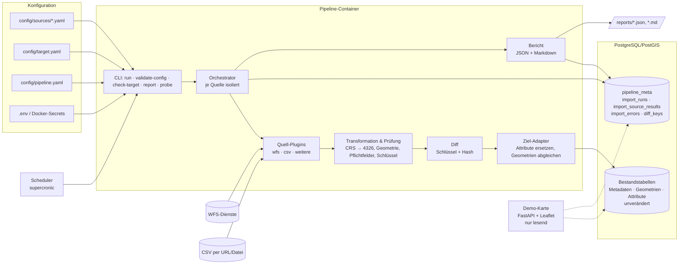

# Architektur

## Technologiewahl: Python

- Die Vorarbeiten der TH (`inkar_import` im Repository MOSIDI-ORG/MOSIDI) sind in Python geschrieben;
  Logik und Know-how lassen sich ohne Technologiebruch überführen.
- Ausgereifte Open-Source-Bibliotheken für OGC-Dienste, Geometrie und Projektionen: httpx, GDAL/OGR über
  pyogrio, Shapely 2, pyproj; pandas für große CSV-Dateien.
- Gut testbar (pytest mit aufgezeichneten Dienstantworten), läuft headless im Container ohne Editor-Server.
- **Node-RED** bleibt anschließbar: Ein Flow kann die CLI per Exec-Node auslösen
  (`docker compose run --rm pipeline run --source <id>`) und den Exit-Code bzw. `reports/latest.json` auswerten.
  Das ist als Option dokumentiert, nicht gebaut.

## Komponenten



| Modul | Aufgabe |
|---|---|
| `geoimport/config/` | Pydantic-Modelle und Laden der YAML-Dateien, `${VAR}`-Ersetzung, Platzhalterregel |
| `geoimport/sources/` | Plugin-Registry; `wfs.py`, `csv_source.py`; Vorlage `_template.py` |
| `geoimport/transform/` | Schlüssel-Normalisierung, Mapping-Ausdrücke, CRS, Geometrieprüfung, Zusammenführung |
| `geoimport/diff.py` | Hash je Datensatz, Vergleich mit dem letzten erfolgreichen Lauf |
| `geoimport/target/` | Ziel-Adapter (`table_mapping`, `demo_reference`), DDL-Sperre, Katalogabfragen |
| `geoimport/meta/` | Schema `pipeline_meta` und Zugriff darauf |
| `geoimport/report/` | Bericht (JSON + Markdown), JSON-Schema |
| `geoimport/orchestrator.py` | Ablauf eines Laufs, Fehlerisolation, Schutzregeln, Sperren |
| `geoimport/cli.py` | Kommandozeile `pipeline` |
| `webmap/` | Demo-Karte (nur Präsentation) |

## Ablauf eines Laufs

```mermaid
sequenceDiagram
  participant C as CLI/Scheduler
  participant O as Orchestrator
  participant S as Quelle (Plugin)
  participant D as Datenbank
  C->>O: run (alle aktiven Quellen oder --source/--group)
  O->>D: pg_try_advisory_lock – sonst Abbruch "Lauf aktiv" (Exit 4)
  O->>D: check-target (Tabellen/Spalten/Typen wie target.yaml?) – sonst Abbruch (Exit 3)
  O->>D: pipeline_meta.import_runs (status=running)
  loop je Quelle (isoliert)
    O->>S: fetch (Wiederholversuche, Timeouts) → Rohdateien data/raw/
    S-->>O: unverändert? (ETag/Hash) → Status unchanged, weiter
    O->>S: parse → gültige Datensätze + Fehler je Datensatz
    O->>O: Fehlerquote, Verknüpfungsprüfung, Schutzregeln (min, max_drop_ratio)
    O->>D: BEGIN; pg_advisory_xact_lock(quelle)
    O->>D: Bestand zählen und lesen, Lieferung in dieselbe Form bringen → Diff (Antwort 62)
    O->>D: Metadatenzeile aktualisieren; DELETE Attribute; Geometrien per Schlüssel UPDATE/INSERT; COPY + INSERT Attribute
    O->>D: COMMIT (bei Fehler ROLLBACK → Bestand bleibt)
    O->>D: import_source_results, import_errors, diff_keys
  end
  O->>D: import_runs abschließen (ok / partial / failed) + Bericht
  O->>C: Bericht JSON + MD, Exit-Code 0/1/2
```

## Erweiterungspunkte

- **Neue Quelle desselben Typs:** nur eine YAML-Datei in `config/sources/` ([Anleitung](neue_quelle_anbinden.md)).
- **Neuer Quelltyp** (z. B. OGC API Features, GeoPackage): Plugin-Klasse + Konfigurationsmodell, registriert über
  `@register_source`; Kern unverändert ([Entwicklung](entwicklung.md)).
- **Neues Zielmodell:** zunächst nur `target.yaml` (Tabellen, Spalten, Layout, Lösch-Strategie); nur für
  grundlegend andere Modelle ein eigener Adapter.

## Sicherheit und Robustheit

- Keine Strukturänderung an Zieltabellen: DDL-Sperre (Whitelist), empfohlene DB-Rolle ohne `CREATE`/`ALTER`.
- Keine Zugangsdaten im Code oder in YAML; Passwörter nur per Umgebungsvariable oder Docker-Secret; Masken in Logs.
- Transaktion je Quelle, Advisory-Locks gegen parallele Läufe, Schutz gegen Leer- und Teilimporte.
- Container ohne root, Datenbankport nur an 127.0.0.1, Demo-Karte nur lesend mit CSP.
