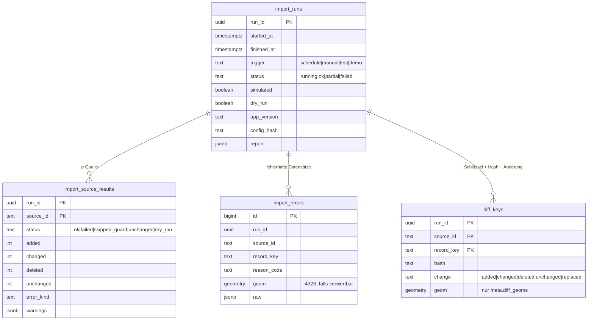

# Datenmodell

## Zieltabellen der TH (bestehend, unverändert)

Laut Leistungsbeschreibung (LB 3, 4.2) besteht das Zielmodell aus drei Tabellen: **Metadaten, Geometrien,
Attribute**. Die Strukturen dürfen nicht verändert werden (Bieterantwort A6). Spalten, Schlüssel und Schema
liegen noch nicht vor; sie werden in `config/target.yaml` eingetragen, sobald die TH die DDL bereitstellt.
Die Pipeline legt in diesem Schema nichts an und ändert nichts. Sie nutzt nur `SELECT`, `INSERT`, `DELETE`
und `UPDATE` (Metadatenzeile der Quelle).

## Abbildung (`config/target.yaml`)

| Bereich | Angaben | Bedeutung |
|---|---|---|
| `metadata` | `name`, `pk`, `dataset_column`, `columns` | eine Zeile je Datensatz (= `target.dataset` der Quelle), wird aktualisiert bzw. angelegt |
| `geometries` | `name`, `pk`, `fk_metadata` oder `source_column`, `object_key_column`, `geometry_column`, `columns` | ein Objekt je Zeile, Geometrie in EPSG:4326 |
| `attributes` | `layout: key_value \| jsonb \| wide`, Spalten je Layout, `fk_metadata`/`fk_geometry`/`source_column`, `object_key_column` | Attribute der Objekte bzw. Kennzahlen der CSV-Quellen |
| `delete_scope` | `by_metadata_source \| by_source_column \| sql` | wie „die Daten derselben Quelle“ gefunden werden |

**Geometrien werden nie gelöscht (Bieterantwort 74).** Beim Ersetzen einer Quelle werden nur ihre Attribute
gelöscht und neu geschrieben. Geometrien (Raumbezüge, z. B. Gemeinden über den AGS) werden über ihren fachlichen
Schlüssel (`object_key_column`) innerhalb des Datensatzes aktualisiert oder neu angelegt. Ihre Primärschlüssel
bleiben dadurch stabil, und Verweise anderer Daten auf eine Geometrie (z. B. Attribute der MOSIDI-Anwendung)
bleiben gültig. Fehlt ein Gebiet in der neuen Lieferung, bleibt seine Geometrie stehen. Nur seine Attribute aus
dieser Quelle entfallen, und der Bericht meldet es als Hinweis `geometry_retained` (Anzahl, bis zu 20 Schlüssel).
Kommt ein Schlüssel im Bestand des Datensatzes mehrfach vor, bricht die Quelle ab, statt eine Geometrie zu raten.

Bei `delete_scope.strategy: sql` gilt: jede Anweisung in `sql` beginnt mit `DELETE`, hat ein `WHERE` mit
`%(dataset)s` oder `%(meta_id)s` und keine weiteren Parameter (ein wörtliches `%` als `%%`). Sie darf nur
Attribute löschen: ein `DELETE` auf die Geometrietabelle wird abgelehnt. Haben die Geometrien weder
`fk_metadata` noch `source_column`, findet `geometry_scope` (eine Bedingung wie `herkunft = %(dataset)s`) die
Geometrien des Datensatzes für den Abgleich. Zusätzlich ist
`scope_sql: {features: …, values: …}` Pflicht: je ein `SELECT`, das genau die Zeilen liefert, die die
`DELETE`-Anweisungen entfernen (bei `features` als erste Spalte der Objektschlüssel). Daraus zählt die Pipeline den
Bestand für die Schutzregeln und den Vergleich. Ohne `WHERE` auf die Quelle wird die Konfiguration abgelehnt.

**Eigenständiger Betrieb ohne MOSIDI-Funktionen (Bieterantworten 74, 75):** Die Pipeline schreibt die
Metadaten selbst in `table_metadata`. Die Herkunft kennzeichnet `dct_catalog_publisher`, befüllt aus
`target.metadata.publisher` der Quelle (INKAR: `BBSR`; die genauen Werte stimmen wir in AP1 ab). Nach einem
Lauf, in dem mindestens eine Quelle geschrieben hat, aktualisiert die Pipeline die materialisierten Sichten aus
`after_import.refresh_materialized_views` (`source_granularities`). Die DDL-Sperre gibt dafür genau
`REFRESH MATERIALIZED VIEW [CONCURRENTLY] <schema>.<sicht>` für diese Sichten frei, alles andere bleibt
gesperrt (auch `WITH NO DATA`). `check-target` prüft, ob die Sicht existiert. Scheitert das `REFRESH`, sind die Daten
trotzdem geschrieben: Es gibt dann eine Warnung `refresh_failed`, der Lauf wird nicht herabgestuft. Probeläufe und
Läufe ohne Änderung aktualisieren nichts. Tabellen- und Spaltennamen außer diesen drei folgen aus dem Schema-Dump.

**Besitz der Datensätze:** Die Pipeline ersetzt nur Metadatenzeilen, die sie selbst angelegt hat
(`pipeline_meta.owned_datasets`: Datensatz, Zieltabelle, Primärschlüssel, anlegender Lauf). Gibt es zu
`target.dataset` bereits eine fremde Zeile (z. B. von MOSIDI gepflegt), bricht die Quelle mit `error.kind`
`ownership` ab, ohne etwas zu ändern. Übernahme nur ausdrücklich und einmalig mit `run --adopt <quelle>`
(Warnung `dataset_adopted`). Zeilen aus Läufen vor Einführung dieser Prüfung (Version 0.10) werden beim ersten
Lauf anhand der Lauf-Historie automatisch übernommen (Warnung `ownership_backfilled`).

Spaltenvorlagen in `columns` (Beispiele): `"{source.title}"`, `"{source.license}"`, `"{source.url}"`,
`"{run.started_at}"`, `"{record.name}"`, `"{record.attr.ags}"`, `"{record.extra}"`.
Datentypen werden aus dem Systemkatalog gelesen; Werte werden beim Einfügen auf den Spaltentyp gecastet.
Ist die Geometriespalte als `MultiPolygon` typisiert, werden Polygone per `ST_Multi` umgewandelt.

**Geometrieprüfung (Bieterantwort 63):** Gespeichert wird nur 2D, auch Multi-Geometrien; Z- und M-Werte
entfallen. Ungültige Geometrien werden repariert statt die Quelle abzubrechen: zuerst in Python
(`shapely.make_valid`), als Schutznetz noch einmal in der Datenbank (`ST_MakeValid`, wenn PostGIS mit einer anderen
GEOS-Version anders urteilt). Die Geometriefamilie bleibt erhalten (aus einer Fläche wird keine Linie). Ist eine
Geometrie leer oder nicht reparierbar, wird der Datensatz mit seinen Attributen übersprungen. Zähler und Warnungen:
`geometry_repaired`, `geometry_skipped` (siehe [Import-Bericht](import_bericht.md)).

**Layouts der Attribut-Tabelle**

- `key_value`: eine Zeile je Attribut bzw. Kennzahl (`name_column`, `value_column`, optional `period_column`).
- `jsonb`: eine Zeile je Objekt bzw. Kennzahl mit allen Werten als JSON (`jsonb_column`).
- `wide`: eine Spalte je Attribut (`wide_columns`), nur für Objekt-Quellen.

## Import-Semantik: Attribute ersetzen, Geometrien abgleichen (A6, Bieterantwort 74)

Je Quelle in **einer** Transaktion:

```sql
BEGIN;
SELECT pg_advisory_xact_lock(hashtext('geoimport:dataset'), hashtext(:dataset));
SELECT pk FROM metadaten WHERE dataset_column = :dataset FOR UPDATE;   -- danach UPDATE bzw. INSERT
DELETE FROM attribute WHERE <Bezug auf die Quelle>;                    -- nur Attribute
COPY tmp_geoimport_geo …;
UPDATE geometrien g SET … FROM tmp_geoimport_geo t                      -- vorhandene: nur bei Änderung
  WHERE g.objekt_schluessel = t.object_key AND <Bezug auf die Quelle> AND ROW(g.…) IS DISTINCT FROM ROW(…);
INSERT INTO geometrien … SELECT … FROM tmp_geoimport_geo t              -- neue Schlüssel
  WHERE NOT EXISTS (SELECT 1 FROM geometrien g WHERE g.objekt_schluessel = t.object_key AND <Bezug>);
COPY tmp_geoimport_attr …; INSERT INTO attribute … SELECT … FROM tmp_geoimport_attr [LEFT JOIN geometrien];
COMMIT;   -- bei jedem Fehler ROLLBACK: der Bestand der Quelle bleibt unverändert
```

- Andere Quellen werden nie berührt (Test `test_other_sources_untouched_and_fault_isolation`).
- Schutz vor Leerimport: Unterschreitet die neue Menge `min_features`/`min_rows` oder fällt sie um mehr als
  `max_drop_ratio` gegenüber dem Bestand, wird nicht ersetzt (Status `skipped_guard`). Übersteuerbar mit
  `--force-replace <id>`; das wird im Bericht vermerkt.
- Fehlerhafte Einzeldatensätze gehen nach `pipeline_meta.import_errors`; die übrigen werden importiert.
  Über `max_error_ratio` (Standard 5 %) gilt die Quelle als fehlgeschlagen.
- Verweise auf Geometrien bleiben gültig, weil Geometrien nicht gelöscht und neu angelegt werden (Test
  `test_foreign_attributes_referencing_geometries_survive`). CSV-Kennzahlen werden im Demo-Modell über den
  Objektschlüssel (AGS) mit den Gemeinden verknüpft.

## Koordinatensystem (A7)

Gespeichert wird ausschließlich **EPSG:4326** (Länge/Breite). Die Pipeline fordert Daten im Quell-CRS an
(z. B. EPSG:25833) und transformiert lokal mit pyproj (`always_xy=True`). Danach wird gegen einen
Plausibilitätsrahmen geprüft; ein Achsentausch wird als Fehler gemeldet, nicht still korrigiert.
Metrische Berechnungen (Umkreis, Fläche) erfolgen zur Abfragezeit über `geography`.

## Lauf-Historie `pipeline_meta` (eigenes Schema)



Diese Tabellen sind die **„Historisierung von Änderungen“** (LB 4.2): Je Lauf ist nachvollziehbar, welche Objekte
einer Quelle neu, geändert oder entfallen sind. Die Zieltabellen bleiben ohne Versionen (A6). Ob ein eigenes Schema
in der Datenbank der TH erlaubt ist, ist offen; alternativ `meta.location: database` (eigene Datenbank auf demselben
Server). Aufbewahrung: `meta.keep_runs`; die Vergleichsbasis jeder Quelle bleibt immer erhalten.

## Demo-Referenzmodell (`ref.*`, nur Demo)

`sql/demo_reference_model.sql` ist eine **Annahme von RIT zur Demonstration**, nicht das Modell der TH:
`ref.metadaten` (Datensatz, Titel, Quelle, Lizenz, Quellenvermerk, Import-Zeitpunkt), `ref.geometrien`
(Objektschlüssel, Name, `geometry(Geometry,4326)`), `ref.attribute` (Name/Wert/Zeitbezug, `zusatz jsonb`).
Es wird nur in Datenbanken angelegt, deren Name auf `_demo` endet.

## Abfragebeispiele

Siehe `sql/beispiele.sql` (Fläche je Gemeinde, Umkreis um den Campus, Kennzahl je Gemeinde, Läufe, Änderungen, Fehler).
